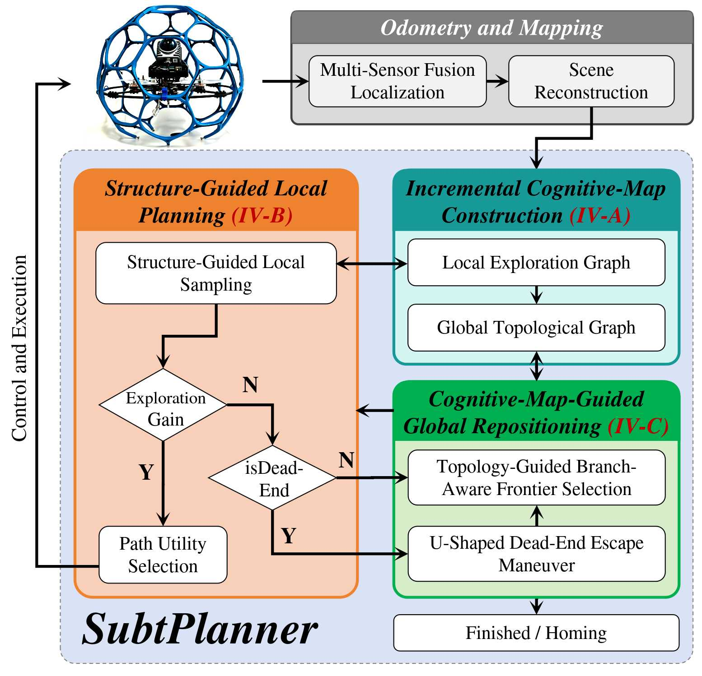
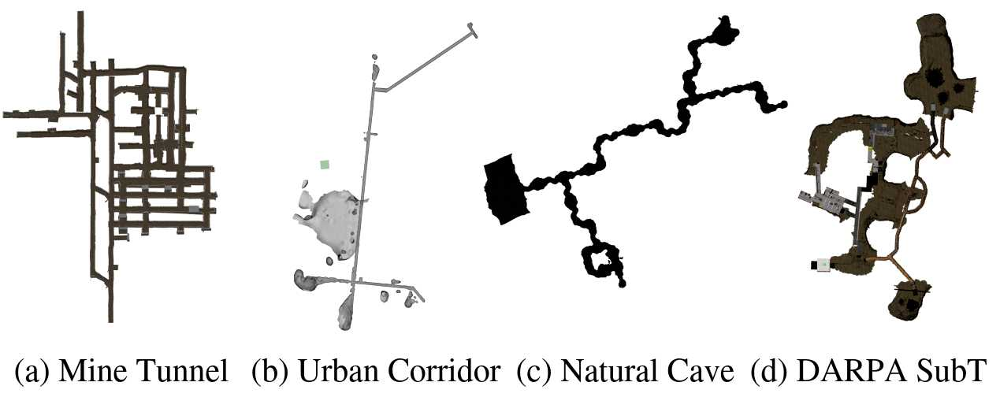
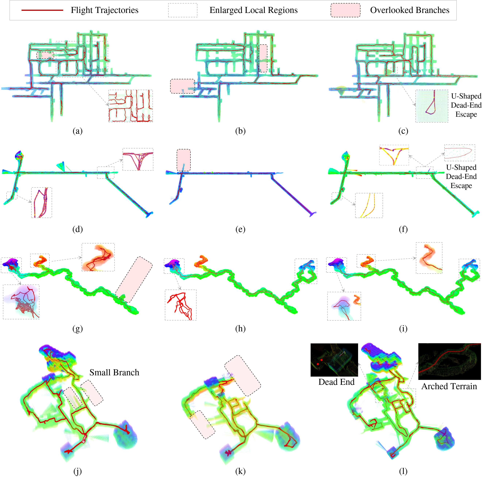

<div align="center">
  <h1>SubtPlanner: Structure-Guided Sampling and Branch-Aware Repositioning for UAV Autonomous Subterranean Exploration</h1>
  <p><strong> </strong></p>
</div>

<p align="center">
  <a href="VIDEO_URL"></a>
  <a href="PAPER_URL"></a>
</p>

## ✨ Overview

***SubtPlanner*** is a cognitive-map-based hierarchical active planner for UAV autonomous exploration in subterranean environments. It couples short-horizon local exploration with long-term topological memory, allowing the robot to keep exploring efficiently in long corridors, branch-rich tunnels, caves, and dead-end-prone spaces.

<p align="center">
  
</p>


The planner is organized around three method concepts:

- **Cognitive map**: an incremental representation composed of a local exploration graph and a global topological graph.
- **Local exploration**: structure-guided sampling using passable directions, field-of-view gain, and safety corridors, dead-zone recognition, and path utility selection.
- **Global repositioning**: dead-zone escape and branch-aware frontier selection with return-path reasoning.

## 🗞️ Updates

- **2026.09** The manuscript has been submitted to ICRA 2027!

## 🎞️ Simulation Preview

<p align="center">
  
</p>

<p align="center">
  
</p>

## 🗂️ Simulation Assets

This repository includes the lightweight `urban_corridor` demo assets for quick testing. Large subterranean simulation environments are based on public DARPA SubT / Open Robotics simulation assets. Please obtain the original large-scale simulation assets from the official sources:

- OSRF SubT repository: https://github.com/osrf/subt
- NTNU-ARL `subt_cave_sim`: https://github.com/ntnu-arl/subt_cave_sim

## ⚙️ Quick Start

### 📦 1. Prerequisites

Required base environment: Ubuntu 20.04, ROS Noetic, GCC 9 / C++17, and Gazebo Classic 11.

```bash
sudo apt update
sudo apt install -y \
  build-essential cmake git git-lfs curl wget \
  python3-catkin-tools python3-vcstool python3-rosdep python3-pip \
  libboost-all-dev libeigen3-dev libgoogle-glog-dev libgflags-dev \
  libprotobuf-dev protobuf-compiler libyaml-cpp-dev libsqlite3-dev libzmq3-dev \
  libpcl-dev libopencv-dev qtbase5-dev
```

### 📥 2. Create Workspace

```bash
mkdir -p ~/SubtPlanner_ws/src
cd ~/SubtPlanner_ws/src
git clone https://github.com/PengSO/SubtPlanner.git

# Download external simulation dependency: rotors_simulator 
cd SubtPlanner/simulation
git clone https://github.com/PengSO/rotors_simulator.git
cd ..
```

<details>
<summary>Optional: recover Git LFS files if checkout failed</summary>

```bash
cd ~/SubtPlanner_ws/src
git lfs pull
git restore --source=HEAD :/
```

</details>

### 🛠️ 3. Build

```bash
cd ~/SubtPlanner_ws
./src/SubtPlanner/scripts/build_subtplanner.sh ~/SubtPlanner_ws
```

<details>
<summary>Optional: manual build commands</summary>

```bash
cd ~/SubtPlanner_ws
source ./src/SubtPlanner/scripts/setup_gazebo_classic_env.sh
rosdep install --from-paths src --ignore-src -r -y
catkin config --cmake-args -DCMAKE_BUILD_TYPE=Release
catkin build
source devel/setup.bash
./src/SubtPlanner/scripts/check_runtime_env.sh ~/SubtPlanner_ws
```

</details>

<details>
<summary>Optional: rebuild simulator plugins if the Gazebo environment changed</summary>

Use this only when the workspace was previously built under a different Gazebo setup, for example after switching from Gazebo Sim / ROS-GZ back to Gazebo Classic 11.

```bash
cd ~/SubtPlanner_ws
./src/SubtPlanner/scripts/rebuild_sim_plugins.sh ~/SubtPlanner_ws
```

</details>

<u>Recommended once after building:</u>

```bash
echo 'source ~/SubtPlanner_ws/src/SubtPlanner/scripts/setup_gazebo_classic_env.sh' >> ~/.bashrc
source ~/.bashrc
```

### 🚁 4. Run Corridor Demo

```bash
cd ~/SubtPlanner_ws
source devel/setup.bash
roslaunch subt_planner urban_corridor.launch
```

<details>
<summary>Optional: run with a temporary shell environment</summary>

```bash
cd ~/SubtPlanner_ws
source ./src/SubtPlanner/scripts/setup_gazebo_classic_env.sh
source devel/setup.bash
roslaunch subt_planner urban_corridor.launch
```

</details>

<details>
<summary>Optional: headless smoke test</summary>

```bash
cd ~/SubtPlanner_ws
source devel/setup.bash
roslaunch subt_planner urban_corridor.launch rviz_en:=false
```

</details>

## 📖 Citation

If this project supports your research, please cite the associated paper:

```bibtex
@inproceedings{subtplanner2027,
  title = {SubtPlanner: Structure-Guided Sampling and Branch-Aware Repositioning for UAV Autonomous Subterranean Exploration},
  author = {Peng, Song and Zhang, Hao and Li, Han and Jiang, Weicheng and Gou, Guohua and Sui, Haigang},
  booktitle = {},
  year = {2027}
}
```

## 🙏 Acknowledgements

We thank the following projects for their valuable influence on subterranean exploration research and simulation workflows:

- [GBPlanner2](https://github.com/ntnu-arl/gbplanner_ros/wiki)
- [OmniPlanner](https://github.com/ntnu-arl/gbplanner_ros)
- [SuperLoc](https://superodometry.com/superloc)
- [voxblox](https://github.com/ethz-asl/voxblox)
- DARPA SubT Challenge / Open Robotics official simulation assets
